# Zeitmanagement für Synology

[](https://buymeacoffee.com/lapalutschi)

[](https://github.com/rinkelzz/zeitmanagement/actions/workflows/ci.yml)
[](https://github.com/rinkelzz/zeitmanagement/releases)
[](LICENSE)

Aufgaben, Projektzeiten, Kalender, Dienstplan und Helpdesk für kleine Firmen, Praxen und Einzelpersonen – als Paket
auf der eigenen Synology NAS, mit eigenem Fenster in DSM. Wer in DSM angemeldet ist, ist es auch hier.
Die Daten bleiben im Haus.

> **Stand:** Version 1.0 – Aufgaben, Kalender mit iCal-Abo fürs Handy, Dienstplan mit Wochen-PDF, Projektzeiten
> mit Auswertung als PDF, Excel und CSV und ein **Helpdesk mit Meldeformular, E-Mail-Postfach, Melder-Portal, Kategorien,
> Textbausteinen, Kennzahlen und Zeit pro Ticket**. Jedes Modul lässt
> sich einzeln abschalten – siehe [Fahrplan](#fahrplan).

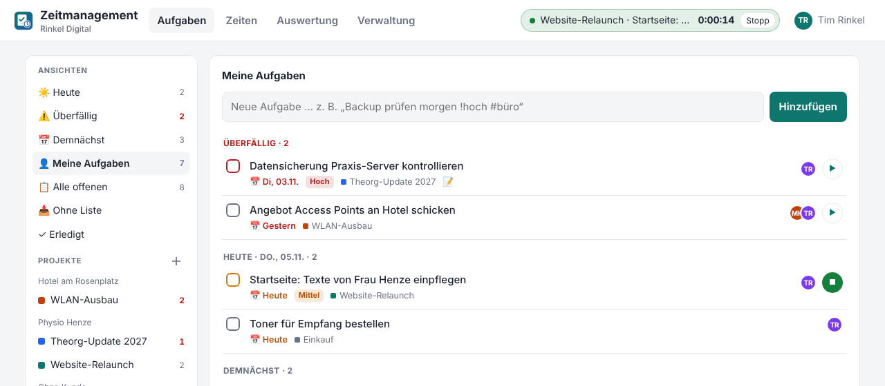

## Inhalt

- [Funktionen](#funktionen)
- [Aufgaben](#aufgaben)
- [Kalender und Abo fürs Handy](#kalender-und-abo-fürs-handy)
- [Dienstplan](#dienstplan)
- [Projektzeiten und Auswertung](#projektzeiten-und-auswertung)
- [Helpdesk](#helpdesk)
- [Module](#module)
- [Fahrplan](#fahrplan)
- [Installation auf der Synology](#installation-auf-der-synology)
- [Updates über das Paket-Zentrum](#updates-über-das-paket-zentrum)
- [Datensicherung](#datensicherung)
- [Von unterwegs erreichbar machen (Reverse Proxy)](#von-unterwegs-erreichbar-machen-reverse-proxy)
- [Port ändern](#port-ändern)
- [Entwicklung](#entwicklung)
- [English](#english)

## Funktionen

- **Aufgaben** mit Fälligkeit, Priorität, Projekten und Aufgabenlisten, Notizen und (im Team) Zuständigen.
  Ansichten Heute, Überfällig, Demnächst, Meine Aufgaben, Alle offenen, Ohne Liste und Erledigt.
- **Wiederkehrende Aufgaben** (täglich, werktags, wöchentlich, monatlich, jährlich, alle N …), **Checklisten** und
  **Erinnerung zu einer Uhrzeit** per Mail.
- **Schnelleingabe** in einer Zeile: „Backup prüfen morgen !hoch #büro @anna“ – die App zeigt vor dem Speichern, was sie erkannt hat.
- **Tägliche Erinnerungs-Mail** mit überfälligen und heute fälligen Aufgaben, Uhrzeit einstellbar, pro Person abschaltbar.
- **Kalender** mit Monat, Woche und Tag, Serienterminen, Teilnehmern und Aufgaben im Kalender – und einem
  **iCal-Abo** für iPhone, Outlook und Google Kalender.
- **Dienstplan** als Wochenraster (Mitarbeiter × Tage) mit eigenen Schichtarten, Urlaub/Krank, Stundensumme und
  Besetzung pro Tag, „Vorwoche übernehmen“, Veröffentlichen mit Mail an alle und **Wochenplan als PDF** zum Aushängen.
- **Projektzeiten** per Stoppuhr (auch direkt an der Aufgabe mit ▶) oder nachgetragen, mit Kennzeichen „vor Ort“.
  Die laufende Stoppuhr steht immer in der Kopfzeile.
- **Helpdesk:** Meldeformular pro Projekt (mit Anhängen) und **E-Mail-Postfach** (IMAP), Tickets mit Verlauf,
  Antworten per Mail (auch zurück ins Ticket), interne Notizen, **Melder-Portal** mit „Meine Tickets“ und Statuslink,
  Kategorien, Textbausteine, Helpdesk-Kennzahlen und Ticket-Bericht als PDF
  und **Stoppuhr direkt am Ticket** – die Zeit landet auf dem Projekt des Kunden.
- **Module einzeln abschaltbar** – z. B. nur Helpdesk oder nur Dienstplan.
- **Auswertung** nach Kunde, Projekt, Aufgabe, Mitarbeiter oder Tag – als **PDF, Excel und CSV**, mit Firmenname und Logo.
- **Projektbudget** in Stunden mit Warn-Mail bei 80 % und 100 %, **„abgerechnet“-Kennzeichen** mit Rechnungsvermerk –
  abgerechnete Zeiten sind gesperrt.
- **Zwei Betriebsarten**, jederzeit umschaltbar:
  - **Einzelperson** – nur du, ohne Benutzer, Rollen und Zuständige. Jeder DSM-Administrator landet in deinem Konto.
  - **Team** – Chef/Admin (darf alles) und Mitarbeiter (sehen nur ihre eigenen Projekte).
- **Eigenes DSM-Fenster** mit **Single Sign-on**: kein zweites Login für DSM-Benutzer. Alternativ Anmeldung mit
  DSM-Konto (inklusive Zwei-Faktor-Code) oder eigenem Konto – z. B. am Handy über den Reverse Proxy.
- **Firmenname und Logo** in Kopfzeile, Anmeldung und Berichten – jede Installation entscheidet selbst.
- **Vier Designs:** Klassisch (folgt hell/dunkel des Geräts), Synology DSM, Dunkel, Warm & groß. Für Handy und Desktop.
- **Nächtliche Datensicherung** in einen freigegebenen Ordner (für Hyper Backup), Wiederherstellen per Klick,
  alte Sicherungen löschbar. Logo und Einstellungen stecken in der Datenbank und sind damit mitgesichert.
- **Updates übers Paket-Zentrum** – die App ist ihre eigene Paketquelle.
- **Änderungsprotokoll** aller wichtigen Aktionen, filterbar und als CSV.
- **Port änderbar** im Installationsassistenten und später in der App – sie startet sich selbst neu.
- **Sicherheit von Anfang an** – siehe [SECURITY.md](SECURITY.md).

| | |
|---|---|
| 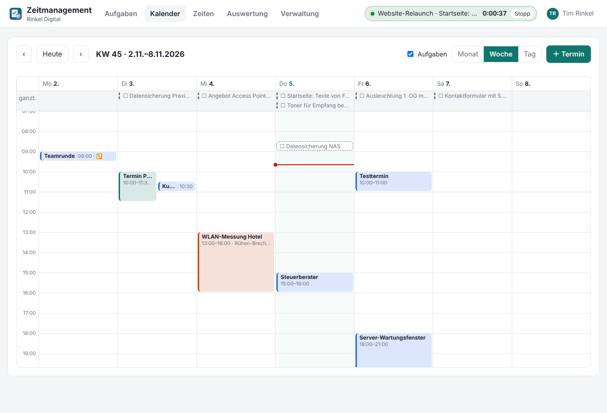 | 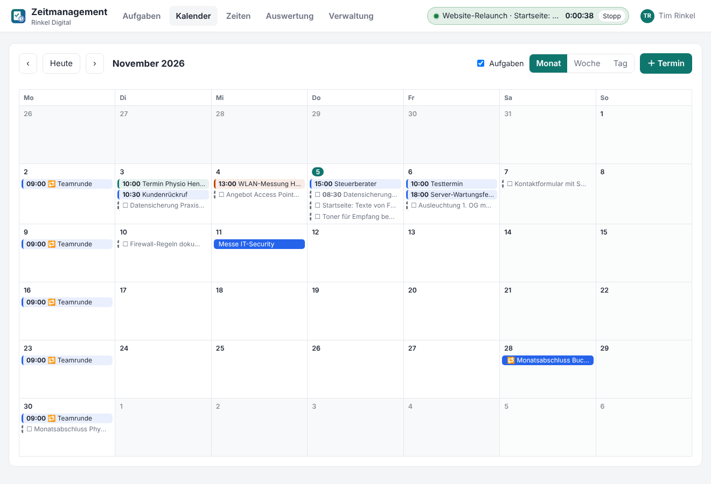 |
| 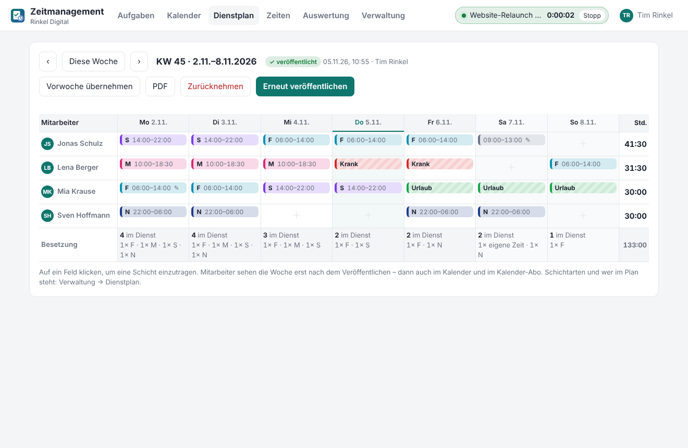 | 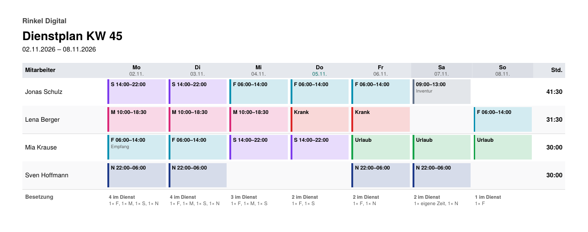 |
| 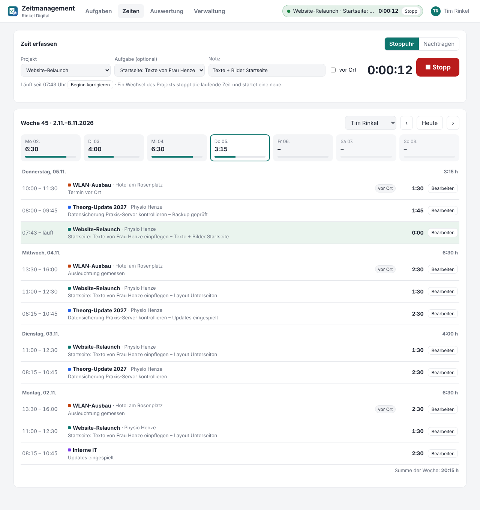 | 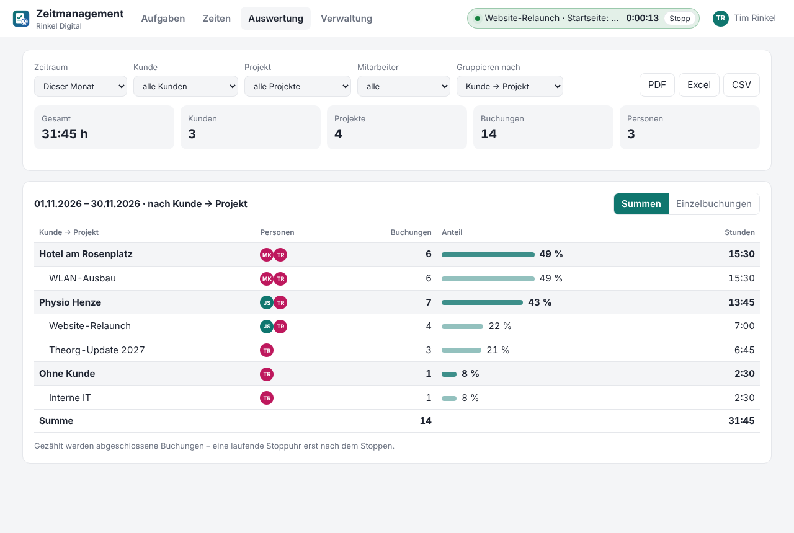 |
| 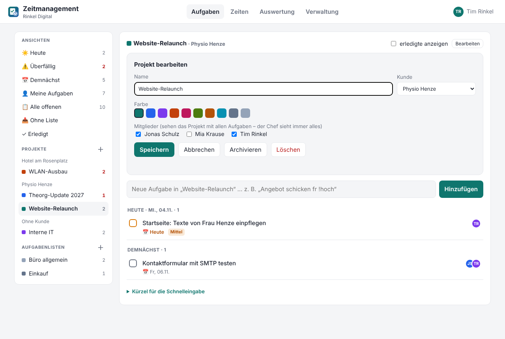 | 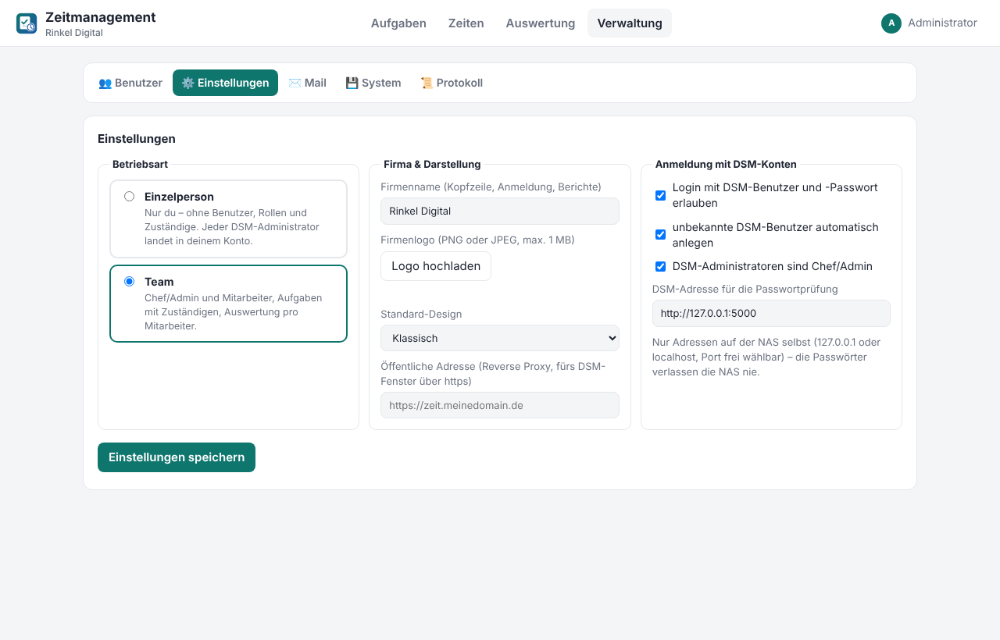 |
| 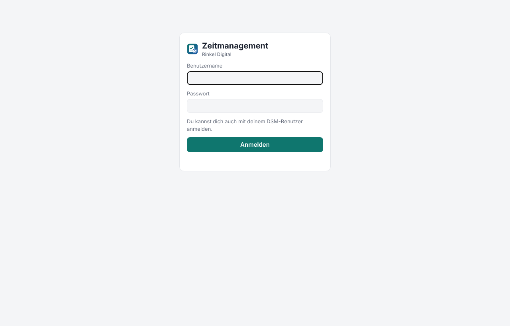 | 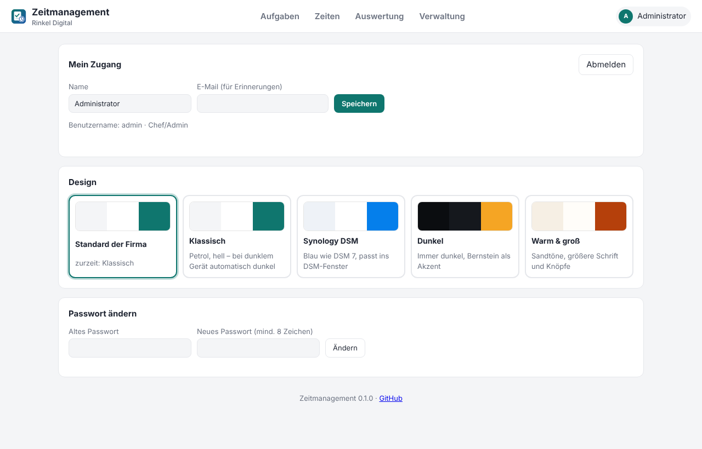 |

## Aufgaben

**Projekte und Aufgabenlisten.** Ein *Projekt* gehört optional zu einem Kunden und ist ab Version 0.3 auch das Ziel für
Zeitbuchungen. Eine *Aufgabenliste* ist eine einfache Sammlung ohne Kunde, z. B. „Büro allgemein“ oder „Einkauf“.
Aufgaben ohne Liste landen unter „Ohne Liste“.

**Wer sieht was (Team-Modus)?**

| | Chef/Admin | Mitarbeiter |
|---|---|---|
| Projekte anlegen | ✅ | – |
| Aufgabenlisten anlegen | ✅ | ✅ (wird automatisch Mitglied) |
| Projekte und Listen sehen | alle | nur die, in denen er Mitglied ist |
| Aufgaben sehen | alle | in seinen Projekten/Listen, ihm zugewiesene und eigene ohne Liste |
| Aufgaben löschen | alle | selbst angelegte |

**Schnelleingabe** – alles in einer Zeile, Reihenfolge egal:

| Kürzel | Bedeutung |
|---|---|
| `heute`, `morgen`, `übermorgen` | Fälligkeit |
| `mo` … `sa`, `so.`, `montag` … `sonntag` | der nächste dieser Wochentage |
| `nächste woche`, `in 3 tagen`, `12.11.`, `12.11.2026` | Fälligkeit |
| `!hoch`, `!mittel`, `!normal` (oder `!1`, `!2`, `!3`) | Priorität |
| `#büro` | Projekt oder Liste – ohne Leerzeichen, der Anfang reicht |
| `@anna` | zuständig (Benutzername oder Vorname, nur im Team) |
| `um 14`, `um 14:30`, `14:30`, `15 uhr` | Uhrzeit – Erinnerung per Mail zu dieser Zeit |
| `täglich`, `werktags`, `wöchentlich`, `monatlich`, `jährlich` | Wiederholung |
| `jeden montag`, `jede woche`, `alle 2 wochen`, `alle 3 monate` | Wiederholung |
| `\morgen` | bleibt als Wort im Titel |

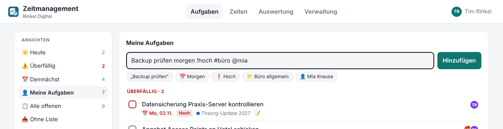

**Wiederholung:** Wird eine wiederkehrende Aufgabe erledigt, legt die App die nächste an – mit Priorität, Liste,
Zuständigen und Checkliste (wieder offen). Der nächste Termin liegt immer nach heute; wer eine tägliche Aufgabe drei Tage
zu spät abhakt, bekommt sie für morgen. Monatliche Aufgaben am 31. kommen nach einem kurzen Monat wieder am 31.

**Checkliste:** Unterpunkte direkt in der Aufgabe (Bearbeiten → „Punkt hinzufügen“), der Fortschritt steht in der Liste (☑ 1/3).

**Erinnerung zur Uhrzeit:** Hat eine Aufgabe eine Uhrzeit, geht zu dieser Zeit eine Mail an die Zuständigen (ohne Zuständige
an die Person, die sie angelegt hat). Mehr als 6 Stunden verspätet (NAS war aus) wird sie übersprungen.

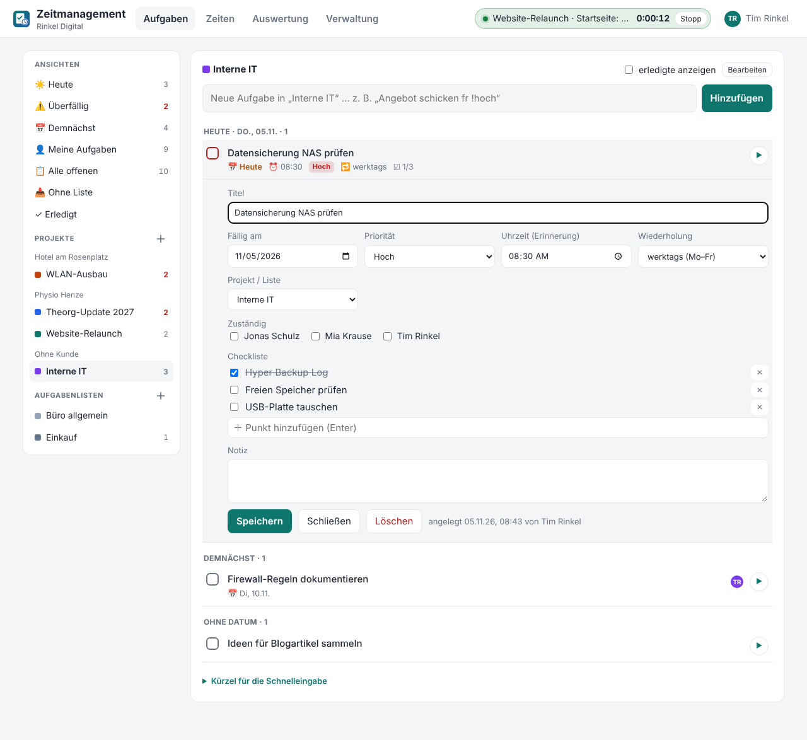

**Erinnerungen:** Unter **Verwaltung → Mail** den Mailserver eintragen und die Uhrzeit wählen (Standard 7 Uhr). Jede Person
mit E-Mail-Adresse bekommt dann morgens eine Sammel-Mail mit ihren überfälligen und heute fälligen Aufgaben – im Team die
ihr zugewiesenen und eigene ohne Zuständige. Ist nichts fällig, kommt keine Mail. Unter **Mein Zugang** lässt sich die
Erinnerung abschalten oder sofort testen.

## Kalender und Abo fürs Handy

**Termine** legst du per Klick ins Raster (Woche/Tag) oder in einen Tag (Monat) an – mit Uhrzeit oder ganztägig,
mehrtägig, mit Ort, Projekt und Notiz. **Serien:** täglich, werktags, wöchentlich, alle 2 Wochen, monatlich, alle 3 Monate,
jährlich, optional mit Enddatum. Einzelne Termine einer Serie lassen sich löschen („Nur diesen Termin“), Änderungen gelten
für die ganze Serie. Uhrzeiten bleiben über die Zeitumstellung hinweg gleich.

**Aufgaben mit Fälligkeit** erscheinen gestrichelt im Kalender (mit Uhrzeit im Raster, sonst in der Zeile „ganztägig“) –
abschaltbar über „Aufgaben“.

**Team:** Ein Termin ist für die Person sichtbar, die ihn angelegt hat, und für die eingetragenen **Teilnehmer**; der Chef
sieht alle. Ändern dürfen nur die anlegende Person und der Chef.

**Abo fürs Handy:** Unter **Mein Zugang → Kalender-Abo** einen persönlichen Link erzeugen und auf dem iPhone unter
*Einstellungen → Kalender → Accounts → Account hinzufügen → Andere → Kalenderabo hinzufügen* eintragen (oder direkt
„Auf diesem Gerät abonnieren“ tippen). Outlook und Google Kalender können denselben Link abonnieren. Im Abo stehen
deine Termine (ab 90 Tagen zurück, Serien als echte Serien), auf Wunsch die fälligen Aufgaben und die eingestellte
**Erinnerung** („15 Minuten vorher“), die dann das Handy auslöst. Für unterwegs braucht es die öffentliche
https-Adresse (Reverse Proxy). Der Link ist geheim wie ein Passwort; „Neuen Link erzeugen“ macht den alten sofort ungültig.

## Dienstplan


Der Reiter **Dienstplan** zeigt eine Woche: links die Mitarbeiter, rechts Montag bis Sonntag, ganz rechts die Stunden
der Woche, unten die **Besetzung** pro Tag (wie viele im Dienst, welche Schichten). So siehst du auf einen Blick, wo
noch jemand fehlt.

**Planen (Chef):** Auf ein Feld klicken und eine **Schichtart** wählen – Frühdienst, Spätdienst, Nachtdienst oder
Abwesenheit wie Urlaub, Krank, Frei. Unter „Eigene Zeiten“ lassen sich Beginn, Ende, Pause und eine Notiz
(z. B. Station oder Filiale) anpassen. Zwei Dienste am selben Tag (geteilter Dienst) gehen, solange sie sich nicht
überschneiden; ein Nachtdienst 22:00–06:00 gehört zum Tag, an dem er beginnt, und wird bei Überschneidungen mit dem
Folgetag berücksichtigt. **„Vorwoche übernehmen“** kopiert die letzte Woche als Vorlage.

| | |
|---|---|
| 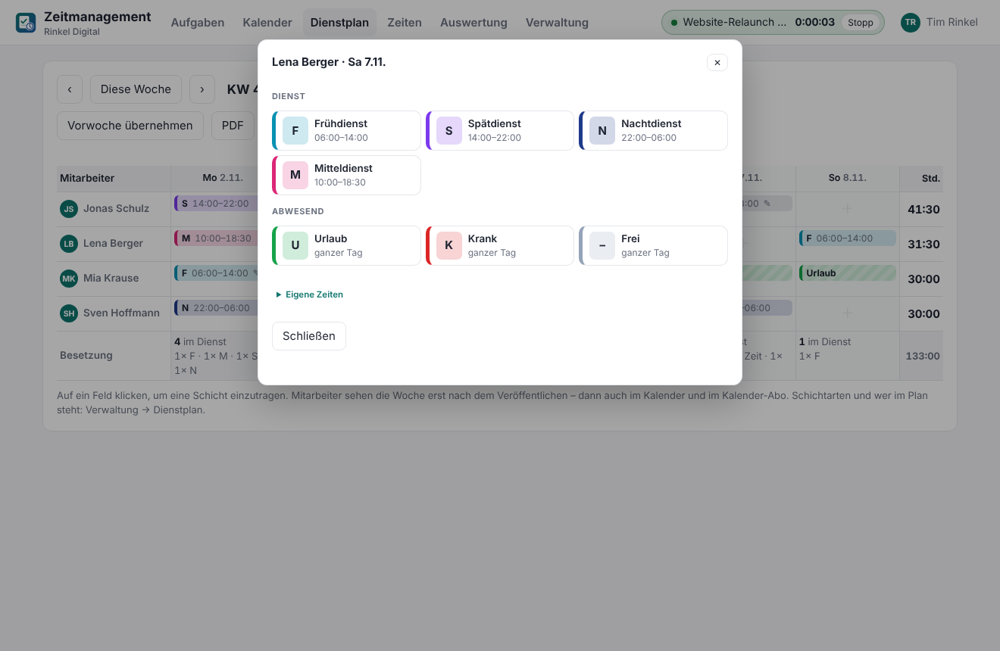 | 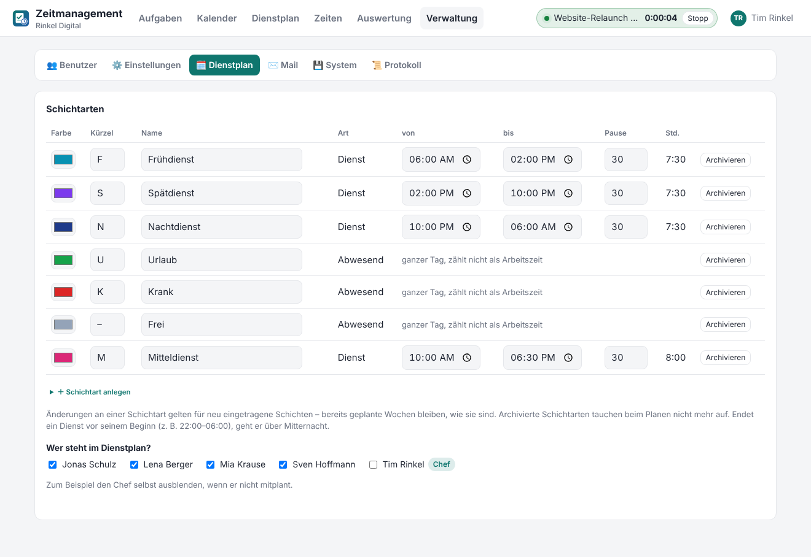 |

**Veröffentlichen:** Solange eine Woche ein **Entwurf** ist, sehen Mitarbeiter sie nicht. Nach „Veröffentlichen“ sieht
das ganze Team den Plan, auf Wunsch bekommt jeder seine Schichten der Woche **per Mail**, und die eigenen Schichten
erscheinen im **Kalender** und im **Kalender-Abo** am Handy. „Zurücknehmen“ blendet die Woche wieder aus.

**PDF:** Der Wochenplan im Querformat mit Firmenname, Logo, Farben, Stunden, Besetzung und Legende – zum Aushängen
am Schwarzen Brett.

**Schichtarten** (Name, Kürzel, Zeiten, Pause, Farbe) pflegst du unter **Verwaltung → Dienstplan**. Änderungen gelten
für neu eingetragene Schichten; bereits geplante Wochen bleiben, wie sie sind. Dort legst du auch fest, **wer im
Dienstplan steht** – etwa den Chef selbst ausblenden. Am Handy steht unter dem Plan zusätzlich „Meine Woche“.

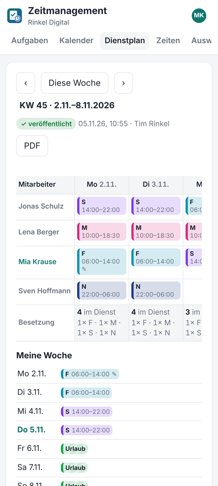

## Projektzeiten und Auswertung

**Buchen.** Zeiten gehen immer auf ein *Projekt* (Aufgabenlisten sind nur für To-dos), optional auf eine Aufgabe darin:

- **Stoppuhr** unter „Zeiten“ oder mit **▶** direkt an einer Aufgabe. Pro Person läuft höchstens eine Uhr – wer ein anderes
  Projekt startet, beendet die laufende automatisch. Die Uhr läuft auf der NAS weiter, auch wenn Browser oder Handy zu
  sind. Den Beginn kann man nachträglich korrigieren; eine vergessene Uhr wird beim Stoppen auf 24 Stunden gekürzt.
- **Nachtragen** mit Datum, von/bis oder Dauer (z. B. `1:30` oder `1,5`). Der Chef kann auch für andere nachtragen.
- **vor Ort** markiert Termine beim Kunden (steht in Auswertung und Export).
- Buchungen derselben Person dürfen sich nicht überschneiden. Ändern und löschen geht in der Wochenansicht.

**Auswerten.** Zeitraum (Woche, Monat, Jahr oder frei), Kunde, Projekt und – für den Chef – Mitarbeiter wählen, gruppieren
nach Kunde → Projekt, Projekt, Projekt → Aufgabe, Mitarbeiter → Projekt oder Tag. Summen oder Einzelbuchungen,
Export als PDF (mit Logo, mehrseitig), Excel (Übersicht + Buchungen) oder CSV (Semikolon, für Excel). Gezählt werden nur
abgeschlossene Buchungen. Ohne Stundensätze und ohne Rundung – die Stunden sind die Grundlage für deine Rechnung.

**Budget.** Für ein Projekt lässt sich ein Stundenbudget eintragen (Projekt → Bearbeiten). Der Verbrauch steht im Projekt
und in der Auswertung; bei 80 % und bei 100 % bekommt der Chef eine Mail – je Schwelle einmal.

**Abrechnen.** In der Auswertung markiert der Chef alle offenen Zeiten der aktuellen Auswahl (oder einzelne Buchungen)
als abgerechnet, optional mit Vermerk wie der Rechnungsnummer. Abgerechnete Zeiten sind gesperrt – niemand kann sie
mehr ändern oder löschen, bis der Chef die Abrechnung zurücknimmt. Der Filter „nicht abgerechnet“ zeigt, was noch
in Rechnung zu stellen ist; Excel und CSV enthalten Datum und Vermerk der Abrechnung.

Im Team sieht ein Mitarbeiter nur seine eigenen Zeiten und kann nur auf Projekte buchen, in denen er Mitglied ist.
Der Chef sieht alles.

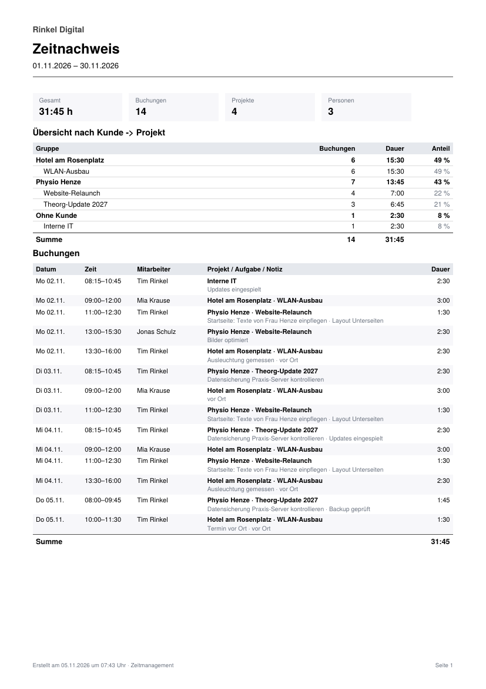

## Helpdesk

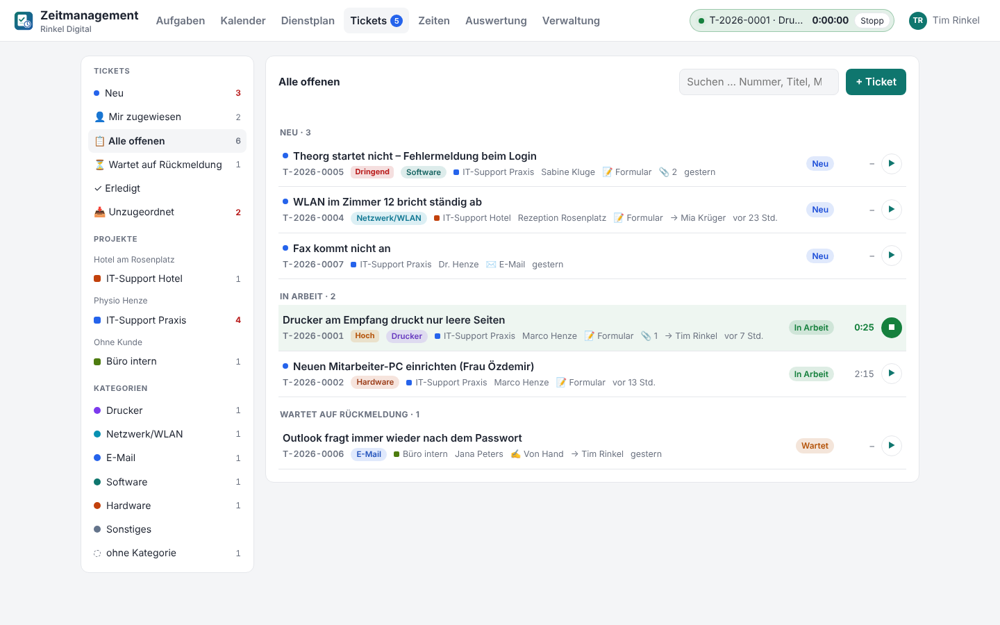

Der Reiter **Tickets** sammelt Problemmeldungen – von den Mitarbeitern deiner Kunden, wenn du IT-Dienstleister bist,
oder im eigenen Betrieb (z. B. an die Haustechnik). Jedes Ticket gehört zu einem **Projekt**: beim Dienstleister ist
das der Kunde („IT-Support Praxis“), intern der Bereich („EDV“, „Haustechnik“). Mitarbeiter sehen nur die Tickets
ihrer Projekte, der Chef alle.

**Meldeformular:** Unter **Verwaltung → Helpdesk** bekommt jedes Projekt per Klick einen eigenen Link, z. B.
`https://zeit.meinedomain.de/melden/k7Qx2mAb9`. Wer ihn hat, kann ohne Anmeldung ein Problem melden – mit
Dringlichkeit und bis zu fünf Bildschirmfotos oder PDFs. Den Link schickst du dem Kunden oder hängst ihn ins Intranet.
Dafür muss die App über den [Reverse Proxy](#von-unterwegs-erreichbar-machen-reverse-proxy) mit https:// erreichbar
sein. „Neuer Link“ macht den alten ungültig.

| | |
|---|---|
| 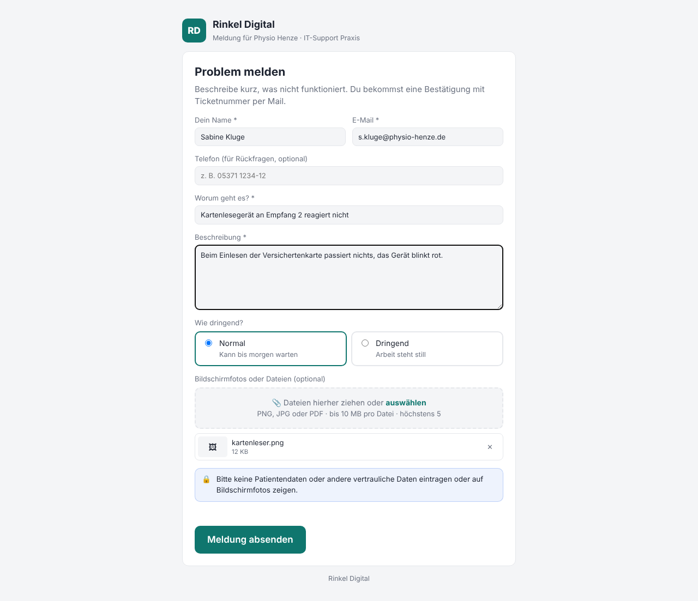 | 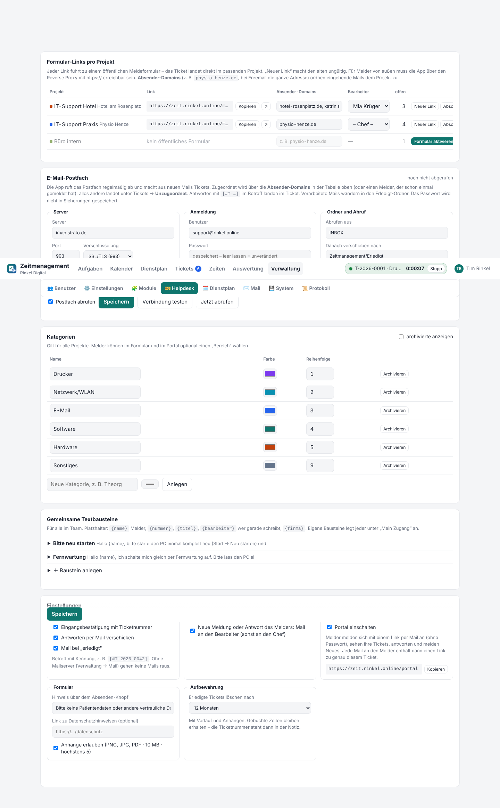 |

Der Melder bekommt eine **Eingangsbestätigung** mit Ticketnummer (`T-2026-0042`), der Bearbeiter des Formulars einen
Hinweis (sonst der Chef). In der **Ticketansicht** antwortest du per Mail (mit Anhängen) oder schreibst **interne
Notizen**, die der Melder nie sieht. Status, Priorität, Bearbeiter und Projekt änderst du oben, „Senden + Erledigt“
schließt das Ticket mit einer letzten Antwort.

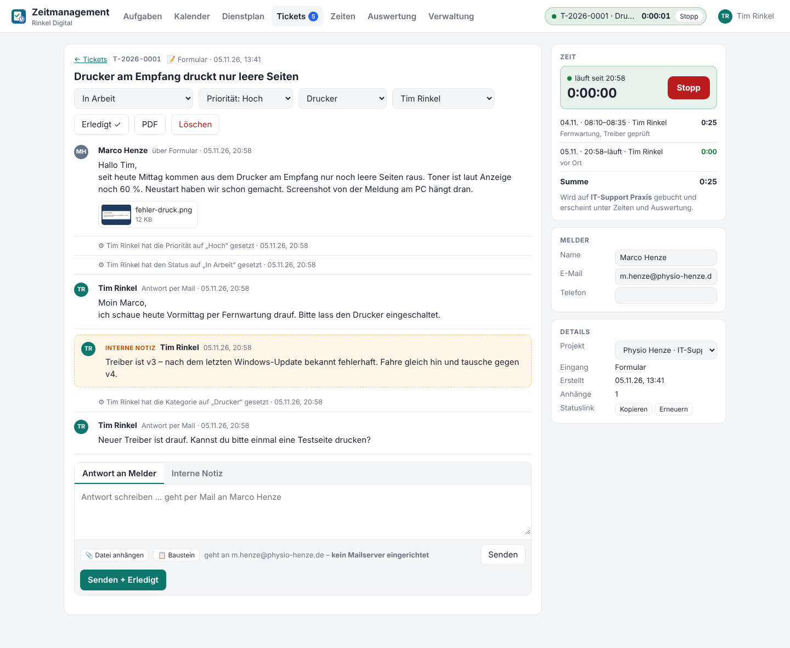

**Zeit pro Ticket:** Mit ▶ in der Liste oder **Start** in der Ticketansicht läuft die Stoppuhr auf das Projekt des
Tickets – mit „vor Ort“, wie gewohnt. Ein neues Ticket ist dann automatisch „in Arbeit“ und gehört dir. Die Zeiten
stehen am Ticket, unter **Zeiten** und in der **Auswertung**.

Erledigte Tickets werden nach einer einstellbaren Frist (Standard 12 Monate) mit Verlauf und Anhängen gelöscht; die
gebuchten Zeiten bleiben, mit der Ticketnummer in der Notiz. Ohne eingerichteten Mailserver funktioniert alles – nur
ohne Mails.

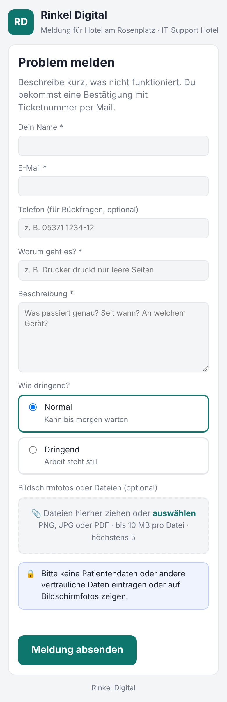 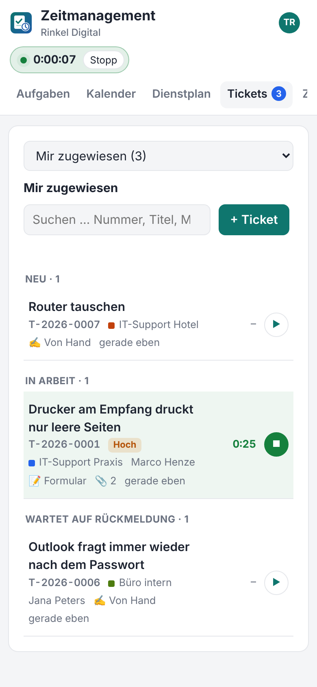

### Meldungen per E-Mail

Unter **Verwaltung → Helpdesk → E-Mail-Postfach** trägst du ein Postfach ein (z. B. `support@deinefirma.de`, IMAP mit
SSL oder STARTTLS). Die App ruft es alle paar Minuten ab:

- **Neue Mail** von einem Melder, der schon einmal gemeldet hat, oder aus einer **Absender-Domain** des Projekts
  (Spalte in der Tabelle „Formular-Links pro Projekt“, z. B. `physio-henze.de`) → neues Ticket mit Eingangsbestätigung.
- **Antwort** mit `[#T-2026-0042]` im Betreff (oder auf unsere letzte Mail) vom Melder bzw. aus seiner Domain →
  landet im Ticket, ohne den zitierten alten Text. Wartende oder erledigte Tickets sind danach wieder „In Arbeit“.
- **Alles andere** → Tickets → **📥 Unzugeordnet**: Projekt wählen, „Ticket anlegen“ – auf Wunsch merkt sich die App
  die Domain fürs nächste Mal. Oder „Verwerfen“.
- Abwesenheitsnotizen, Rückläufer und Newsletter werden ignoriert. Verarbeitete Mails wandern in den Ordner
  `Zeitmanagement/Erledigt`, nichts wird gelöscht.

| | |
|---|---|
| 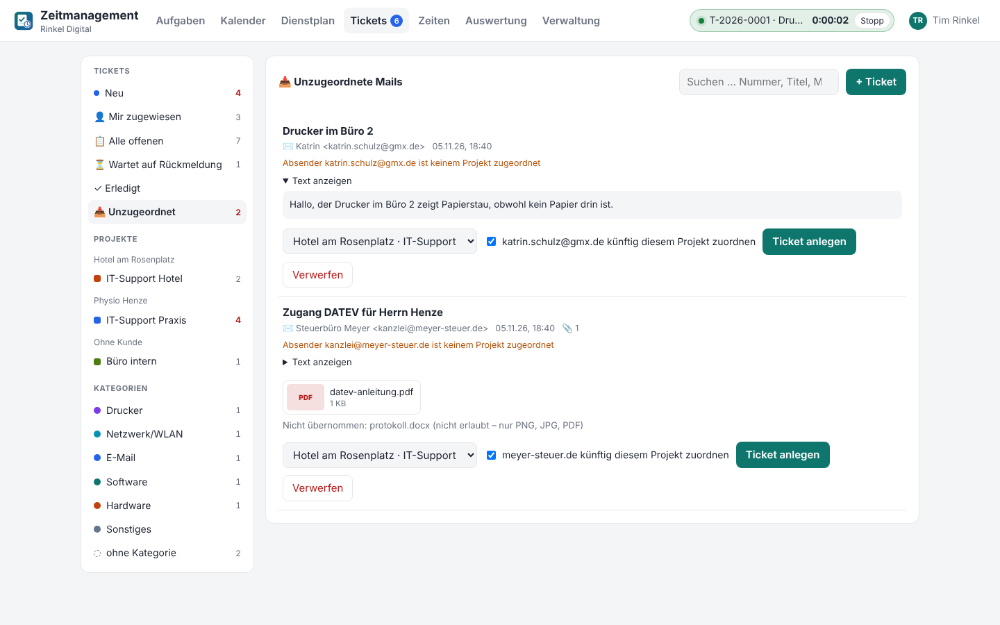 | 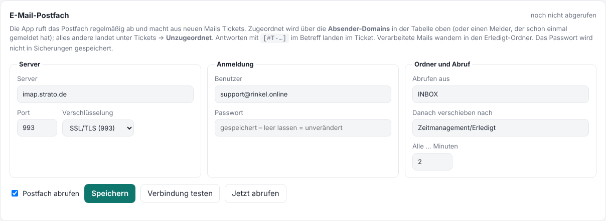 |

Tipp: Am besten ein eigenes Postfach nur für den Support anlegen – die App verschiebt **alle** Mails aus dem
Abruf-Ordner.

### Melder-Portal

Unter **Verwaltung → Helpdesk → Melder-Portal** eingeschaltet, finden deine Melder unter `https://…/portal` ihre
Tickets. Angemeldet wird mit einem **Link per Mail** – kein Passwort, kein Konto anlegen. Einen Link bekommt nur, wer
schon gemeldet hat oder zu einer Absender-Domain eines Projekts gehört.

| | |
|---|---|
| 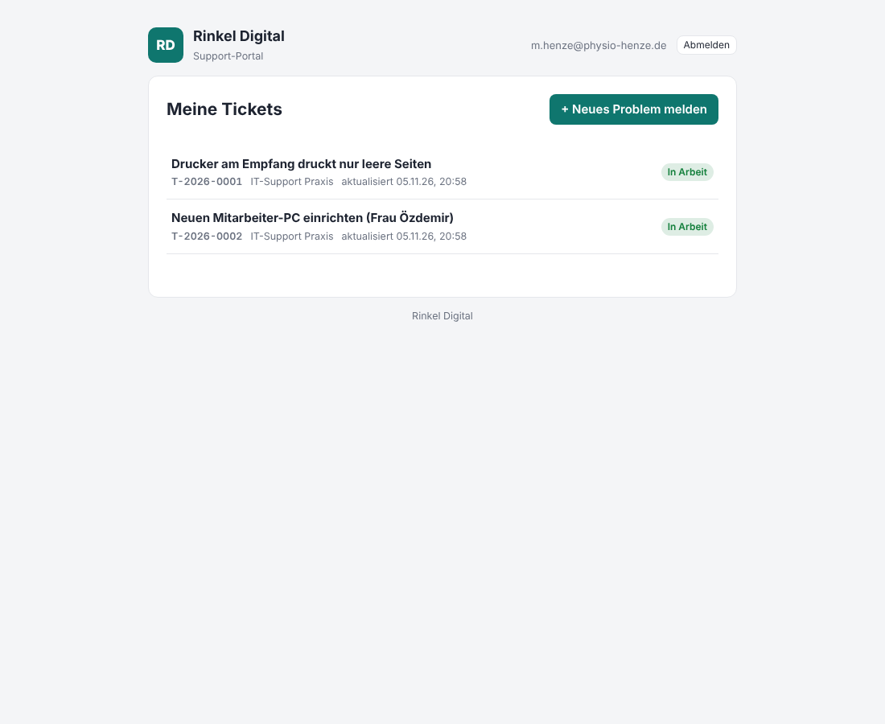 | 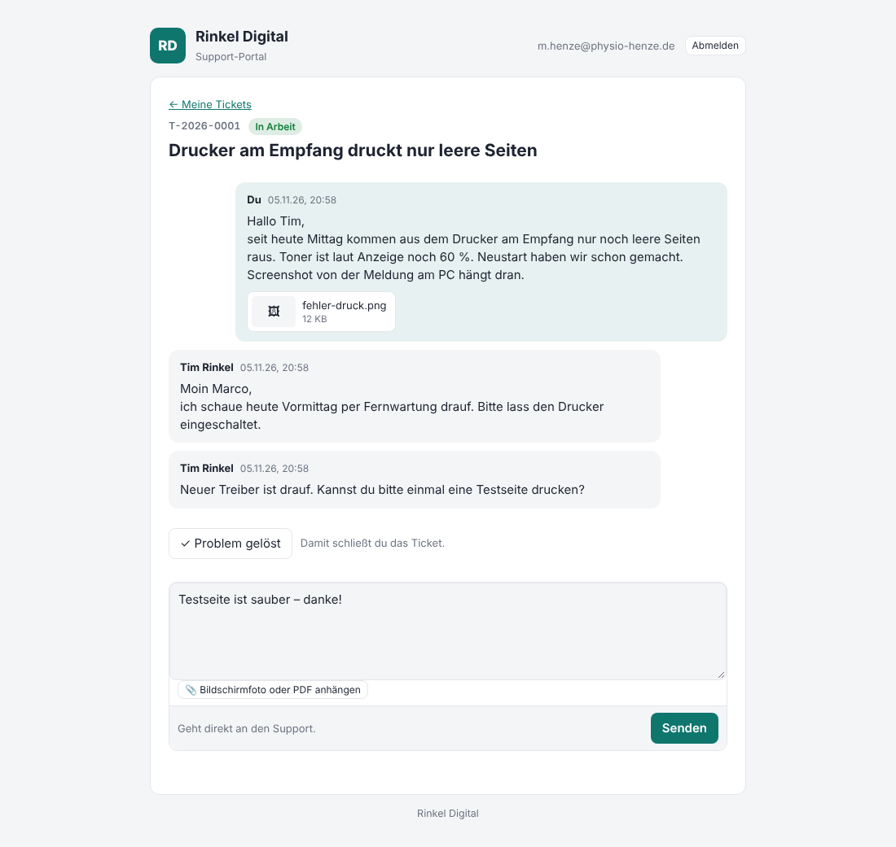 |

Im Portal sieht der Melder nur seine eigenen Tickets – mit seinen Meldungen und deinen Antworten, **nie interne
Notizen oder Zeiten**. Er kann antworten (mit Bildschirmfotos), mit „✓ Problem gelöst“ selbst schließen, mit
„Problem besteht noch“ wieder öffnen und neue Probleme melden.

Jede Mail an den Melder enthält außerdem einen **Statuslink** zu genau diesem Ticket – ohne Anmeldung, praktisch am
Handy. In der Ticketansicht kopierst du ihn oder erneuerst ihn, falls er in falsche Hände geraten ist.

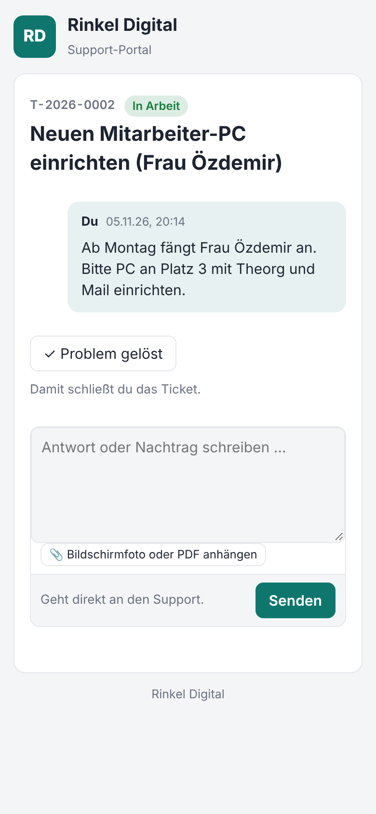

### Kategorien, Textbausteine, Kennzahlen

- **Kategorien** (Drucker, Netzwerk/WLAN, E-Mail, … – frei änderbar unter Verwaltung → Helpdesk) gelten für alle
  Projekte. Melder wählen optional einen „Bereich“, du änderst ihn am Ticket. In der Seitenleiste filterst du danach.
- **Textbausteine:** Im Antwortfeld fügt „📋 Baustein“ fertige Texte ein – mit `{name}`, `{nummer}`, `{titel}`,
  `{bearbeiter}` und `{firma}` schon ersetzt. Gemeinsame pflegt der Chef, eigene jeder unter „Mein Zugang“.
- **Auswertung:** Gruppierung „Ticket“ und Filter „Kategorie“ für die Zeiten; darunter für den Chef die
  **Helpdesk-Kennzahlen** mit Reaktions- und Lösungszeit nach Kunde, Kategorie, Quelle und Monat.
- **Ticket-Bericht als PDF** – z. B. als Anlage zur Rechnung, interne Notizen nur auf Wunsch.

| | |
|---|---|
| 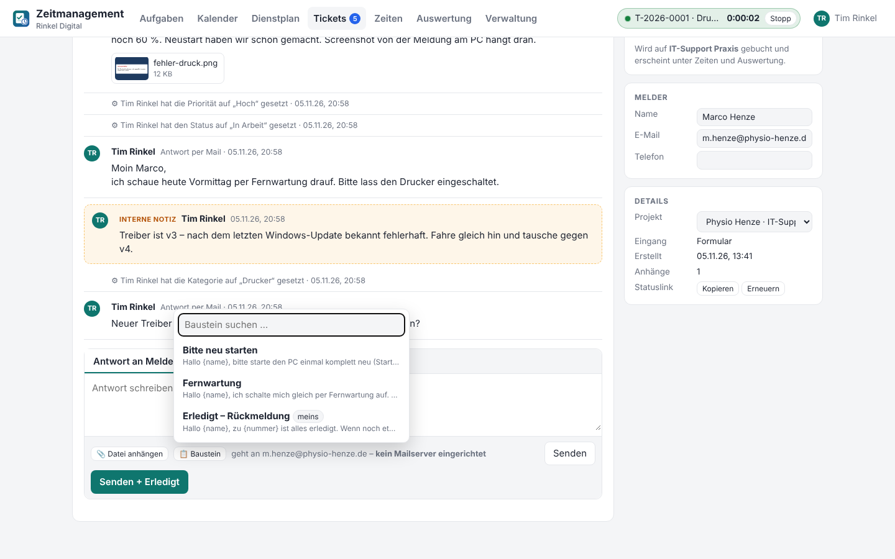 | 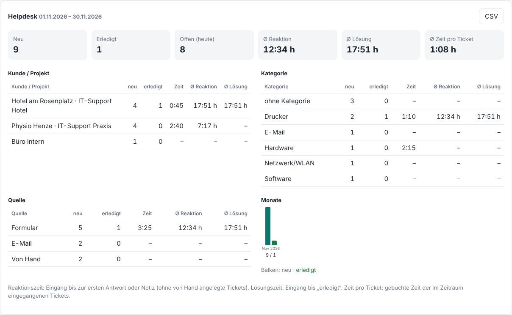 |
| 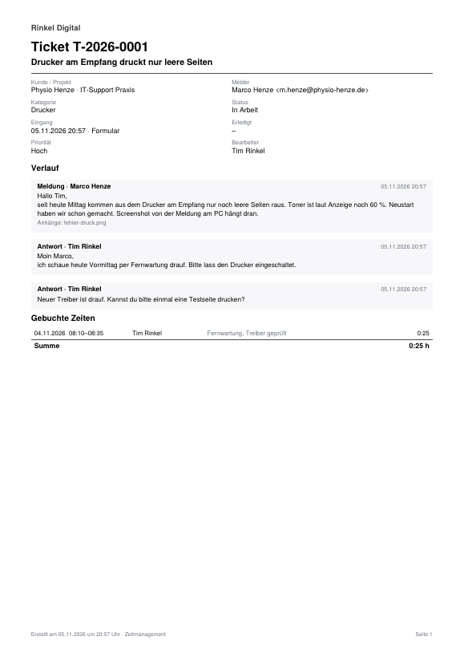 | 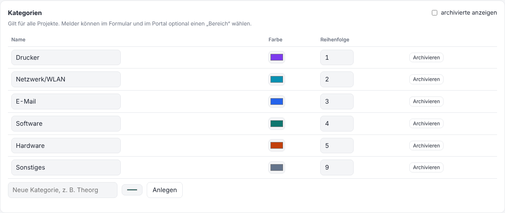 |

## Module

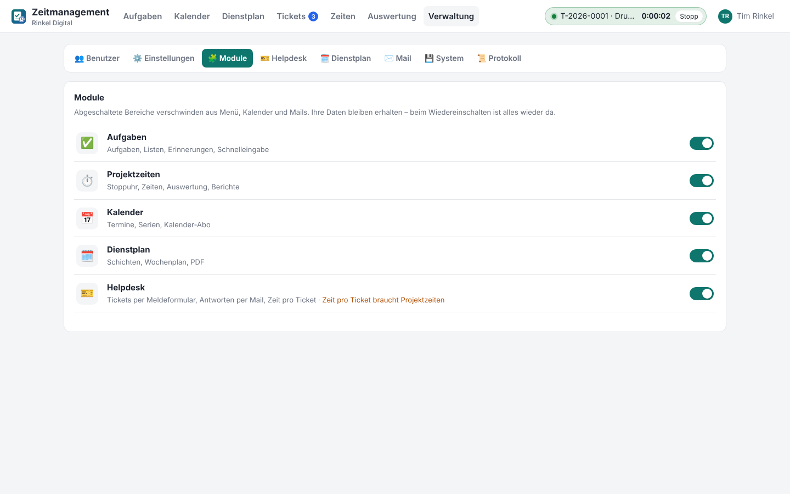

Unter **Verwaltung → Module** schaltest du Aufgaben, Projektzeiten, Kalender, Dienstplan und Helpdesk einzeln an
oder aus. Abgeschaltete Bereiche verschwinden aus Menü, Kalender, Abo und Mails – die Daten bleiben erhalten. So
lässt sich die App auch nur als Helpdesk oder nur als Dienstplan nutzen. Der **Helpdesk ist nach dem Update auf 0.7
aus** und muss einmal eingeschaltet werden.

## Fahrplan

| Version | Inhalt |
|---|---|
| **0.1** ✅ | Fundament: Anmeldung (lokal + DSM, SSO), Einzelperson/Team, Benutzer, Firma & Logo, Designs, Mail, Port, Datensicherung, Updates, Protokoll |
| **0.2** ✅ | **Aufgaben:** Aufgabenlisten und Projekte, Fälligkeit, Priorität, Zuständige, Schnelleingabe („morgen !hoch“), tägliche Erinnerungs-Mail |
| **0.3** ✅ | **Projektzeiten:** Kunden und Projekte, Stoppuhr oder Nachtragen, Auswertung nach Kunde/Projekt/Mitarbeiter, Export PDF/Excel/CSV |
| **0.4** ✅ | Wiederkehrende Aufgaben, Checklisten, Erinnerung zur Uhrzeit, Projektbudget mit Warnung, „abgerechnet“ mit Sperre |
| **0.5** ✅ | **Kalender:** Monat/Woche/Tag, Serien, Teilnehmer, Aufgaben im Kalender, iCal-Abo fürs Handy |
| **0.6** ✅ | **Dienstplan:** Wochenraster, Schichtarten, Urlaub/Krank, Besetzung, Vorwoche übernehmen, Veröffentlichen mit Mail, Wochen-PDF, Schichten im Kalender |
| **0.7** ✅ | **Helpdesk:** Meldeformular pro Projekt mit Anhängen, Tickets mit Verlauf, Antworten per Mail, interne Notizen, Zeit pro Ticket, Aufbewahrungsfrist · **Module** an/aus |
| **0.8** ✅ | **Helpdesk per E-Mail:** IMAP-Postfach, Absender-Domains je Projekt, Posteingang „Unzugeordnet“, Antworten landen im Ticket |
| **0.9** ✅ | **Melder-Portal:** Anmelde-Link per Mail, Meine Tickets, Antworten mit Anhängen, „Problem gelöst“, neues Problem melden, Statuslink in jeder Mail |
| **1.0** ✅ | **Helpdesk-Komfort:** Kategorien, Textbausteine (gemeinsam + persönlich), Zeit pro Ticket in der Auswertung, Helpdesk-Kennzahlen, Ticket-Bericht als PDF |

## Installation auf der Synology

Voraussetzung: DSM 7. Ein Paket für alle Modelle – **Intel/AMD** und **ARM** (ARMv8, ARMv7).

1. Unter [Releases](https://github.com/rinkelzz/zeitmanagement/releases) die neueste
   `zeitmanagement-<version>-0001-noarch.spk` herunterladen.
2. DSM → **Paket-Zentrum** → **Manuelle Installation** → SPK auswählen → Hinweis zu Drittanbieter-Paketen bestätigen.
3. Im Assistenten wählen:
   - **Nur ich** oder **Ein Team** (später änderbar),
   - ein Passwort für den Benutzer `admin` (mindestens 8 Zeichen),
   - optional den **Firmennamen**,
   - den **Port** (Standard `8770` – nur ändern, wenn er schon belegt ist).
4. „Zeitmanagement“ erscheint im DSM-Hauptmenü.

Das Paket nutzt das Python der NAS (3.8 bis 3.13). Fehlt es, bricht die Installation mit einem Hinweis ab –
dann im Paket-Zentrum „Python 3.9“ installieren. Die Daten liegen unter `/var/packages/zeitmanagement/var/` und
bleiben bei Updates erhalten. **Beim Deinstallieren werden sie gelöscht** – deshalb die
[Datensicherung](#datensicherung) einrichten.

## Updates über das Paket-Zentrum

Die App ist ihre eigene Paketquelle – neue Releases von GitHub erscheinen im Paket-Zentrum zum Aktualisieren.
Einmalig einrichten:

1. **Paket-Zentrum → Einstellungen → Allgemein → Vertrauensebene:** „Beliebiger Herausgeber“
   (das Paket ist nicht von Synology signiert).
2. **Paket-Zentrum → Einstellungen → Paketquellen → Hinzufügen:** Name `Zeitmanagement`,
   Ort `http://127.0.0.1:8770/spk` (bei geändertem Port entsprechend – die genaue Adresse steht in der App
   unter **Verwaltung → System → Updates**).

Die App prüft etwa alle 30 Minuten (oder per „Jetzt prüfen“), lädt eine neue SPK auf die NAS und bietet sie dort an.
Die Paketquelle antwortet nur im lokalen Netz.

## Datensicherung

Die App sichert die Datenbank jede Nacht (Standard 2 Uhr) und behält die letzten 7 Sicherungen im Paketordner.
Weil DSM diesen Ordner beim Deinstallieren löscht und Hyper Backup ihn nicht erfasst, gehört zusätzlich ein
**freigegebener Ordner** dazu:

1. **Systemsteuerung → Freigegebener Ordner** → z. B. `backup` → **Bearbeiten → Berechtigungen** →
   oben **System-interner Benutzer** wählen → `zeitmanagement` **Lesen/Schreiben** geben.
2. In der App unter **Verwaltung → System → Datensicherung** den Ordner eintragen, z. B.
   `/volume1/backup/zeitmanagement` (die App prüft die Schreibrechte), und die Aufbewahrung in Tagen festlegen.
3. Den freigegebenen Ordner in Hyper Backup aufnehmen.

Sicherungen lassen sich dort auch von Hand erstellen, herunterladen, wiederherstellen und löschen (die neueste ist
geschützt); vor dem Wiederherstellen wird der aktuelle Stand automatisch gesichert. Das **Mail-Passwort wird nicht
mitgesichert** – auf einer neuen NAS trägst du es einmal neu ein. Den Ordner bitte **nicht für alle freigeben**.

## Von unterwegs erreichbar machen (Reverse Proxy)

Für Handy und Laptop unterwegs braucht die App eine eigene https-Adresse, z. B. `https://zeit.meinedomain.de`:

1. DNS-Eintrag für die Subdomain auf die NAS zeigen lassen (z. B. CNAME auf die DDNS-Adresse).
2. **Systemsteuerung → Sicherheit → Zertifikat**: Let's-Encrypt-Zertifikat für die Subdomain.
3. **Systemsteuerung → Anmeldeportal → Erweitert → Reverse Proxy**: Quelle `HTTPS zeit.meinedomain.de:443`,
   Ziel `HTTP localhost:8770`.
4. In der App unter **Verwaltung → Einstellungen → Öffentliche Adresse** genau diese Adresse eintragen.

**Wichtig:** Den Port im Router **nicht** direkt freigeben – sonst laufen Passwörter unverschlüsselt durchs Internet.
Greift jemand per `http://` von außerhalb des Heimnetzes zu, zeigt die App einen Warnhinweis.

## Port ändern

Unter **Verwaltung → System → Port** einen neuen Port eintragen (1025–65535, nicht von DSM belegt). Die App prüft,
ob er frei ist, speichert ihn in `/var/packages/zeitmanagement/var/config.env` und startet sich selbst neu.
Im DSM-Fenster geht es danach einfach weiter. Anpassen musst du nur, was du selbst eingerichtet hast:
die **Paketquelle** im Paket-Zentrum und das **Ziel im Reverse Proxy**.

## Entwicklung

```bash
pip install -r requirements-dev.txt
pytest -q                                   # alle Tests
ZM_DATA_DIR=./data python -m app.main       # startet auf http://localhost:8770
```

Beim ersten Start ohne `ZM_ADMIN_PASSWORD` steht das Admin-Passwort in `data/ERSTES_ADMIN_PASSWORT.txt`.
Die SPK baut `./synology/build_spk.sh` (lädt die Abhängigkeiten für Python 3.8–3.13 und alle Prozessoren von PyPI).

- **Technik:** Python + FastAPI + SQLite, statisches HTML/CSS/JS ohne Build-Schritt, keine nativen Bibliotheken.
- **Datenbank-Migrationen** über `PRAGMA user_version` in `app/db.py`: Neue Tabellen und Spalten kommen immer als
  neuer, nummerierter Schritt dazu; jeder Schritt läuft in einer eigenen Transaktion. Die Tests spielen jede
  Ausgangsversion durch.
- **Tests** laufen bei jedem Push auf Python 3.8 und 3.13 (GitHub Actions „Tests“).
- **Release:** Version in `app/__init__.py` und `CHANGELOG.md` eintragen, pushen, dann
  **Actions → Release → Run workflow** – baut die SPK und legt das GitHub-Release an.

## Lizenz

[MIT](LICENSE) – frei nutzbar, auch kommerziell. Gefällt dir die App? [Spendier mir einen Kaffee ☕](https://buymeacoffee.com/lapalutschi)

## English

**Zeitmanagement** is a self-hosted package for Synology NAS (DSM 7) for small businesses, medical practices and
individuals: tasks, project time tracking, calendar, shift planning and a helpdesk – in its own DSM window with single sign-on
for DSM users. The user interface is German.

- One noarch package for Intel/AMD and ARM, no native libraries; uses the NAS's Python 3.8–3.13.
- Single-person or team mode, DSM login incl. 2FA, company name and logo, four themes, nightly backups to a shared
  folder (for Hyper Backup), updates through Package Center (the app is its own package source), audit log,
  configurable port.
- Tasks (0.2): projects and task lists, due dates, priorities, assignees, one-line quick add
  („Backup prüfen morgen !hoch #büro @anna“), daily reminder email.
- Project time tracking (0.3): stopwatch (also straight from a task), manual entries, “on site” flag, weekly view,
  reports by customer/project/task/employee/day with PDF, Excel and CSV export.
- Comfort (0.4): recurring tasks, checklists, reminders at a set time, project budgets with warnings, “billed” flag that
  locks entries.
- Calendar (0.5): month/week/day views, recurring events, attendees, tasks shown in the calendar, and a private iCal
  subscription link for iPhone, Outlook or Google Calendar.
- Shift planning (0.6): weekly roster (employees × days) with configurable shift types, absences, weekly hours and
  daily staffing, copy previous week, publish with email to everyone, landscape PDF for the notice board, and published
  shifts in the calendar and the iCal feed.
- Helpdesk (0.7): a public report form per project (with PNG/JPG/PDF attachments, rate limited), tickets with history,
  replies by email, internal notes, a stopwatch per ticket that books time on the customer's project, and a retention
  period for closed tickets. Since 0.8 also an IMAP mailbox: new mails become tickets (matched by sender domain per
  project, unknown senders go to an inbox), replies with the ticket number land in the ticket. Since 0.9 a requester
  portal with passwordless email login, “my tickets”, replies, “resolved/still broken” and a per-ticket status link in
  every email. 1.0 adds ticket categories, canned replies with placeholders, helpdesk metrics (response/resolution
  time) and a ticket report as PDF. Every module (tasks, time tracking, calendar, shift planning, helpdesk) can be switched off.

Install: download the `.spk` from [Releases](https://github.com/rinkelzz/zeitmanagement/releases) →
Package Center → Manual Install. Security notes: [SECURITY.md](SECURITY.md). License: MIT.

Like it? [Buy me a coffee ☕](https://buymeacoffee.com/lapalutschi)
